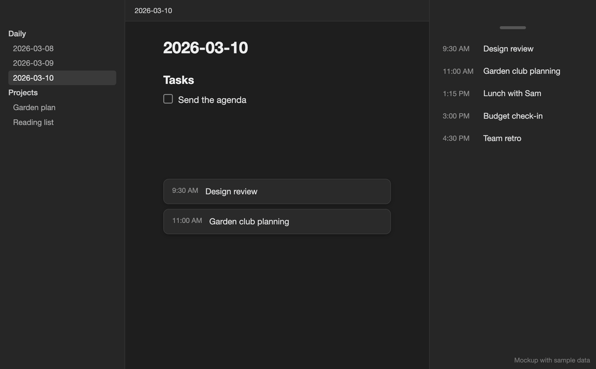

# Simple Meeting Sidebar

> **Mac + mobile.** Macs read Apple Calendar and publish a vault snapshot. iPhone, iPad, Android, Windows and Linux read that synced snapshot. Requires Obsidian 1.8.7 or newer.

Simple Meeting Sidebar shows today's Apple Calendar events in the right sidebar and as inline meetings in daily notes. One click adds an event to your daily note as a task or creates a meeting note. To set it up, allow Calendar access on your Mac and pick which calendars to include.



*Mockup with sample data.*

## Getting started

1. Install and enable **Simple Meeting Sidebar** from Obsidian's Community plugins. Version 0.9.0 is a stable release, so you don't need BRAT.
2. Allow Calendar access when macOS asks. The plugin only reads events and never writes to Apple Calendar.
3. Open the plugin settings and choose which Apple calendars to include.

On desktop, the view opens in the right sidebar on first launch. On mobile, it opens only when you ask. If you close it, run **Simple Meeting Sidebar: Toggle meetings sidebar** to bring it back. Drag the small pill at the top to move the view, or click it to refresh today's meetings.

## Mobile and multiple Macs

Every Mac publishes after a successful calendar refresh, and there's no toggle for this. Use the same Apple Calendar accounts on all your Macs. Enabled calendars stay in the normal synced plugin settings. The fetch with the newer start time wins, and devices reject anything older than the newest valid snapshot they've received, so keep device clocks set automatically.

1. Update the plugin on your Mac and phone, then refresh meetings on the Mac.
2. Sync `Meetings/_calendar/events.json` as an ordinary vault file. The path is fixed, independent of your meeting-note folder and settings profile.
3. With Obsidian Sync, enable **Sync all other types** on each device and ensure `Meetings/_calendar` is not excluded. [Obsidian's sync settings](https://obsidian.md/help/sync/settings) explain the device-specific options.
4. Enable **Inline meetings** if you want them. Mobile uses the same Obsidian editor extension and reading-mode footer, with time and title on one line above three separate 44px touch controls. Long titles are truncated to keep banners compact.
5. Open **Toggle meetings sidebar** when you want the list, since the plugin never opens the mobile sidebar by itself. **Reload synced meetings** reads the file the phone already has and doesn't ask a Mac to refresh.

Mobile shows an update time and tells an empty day apart from missing data. Saved meetings stay available as they age, but banners need a valid snapshot read that fully covers the phone's current day, matches the calendar selection, and was fetched less than an hour ago. Invalid, missing, conflicting, or older files suppress banners but keep the last valid sidebar data.

The Mac refresh schedule doesn't change, so a daily schedule gives mobile banners only a short window. Choose hourly refresh for more frequent updates while a Mac is open. Even a fresh snapshot can't show a cancellation that hasn't reached Apple Calendar or vault sync.

Mobile reads the snapshot on startup, when it changes, and when the app resumes. It doesn't poll or contact Apple Calendar. One local timer updates the date at midnight, reveals tomorrow's meetings at 5pm local time (unless the week ahead is shown), and removes expired banners. Banners disappear at the scheduled start time, while the sidebar keeps a meeting until you dismiss or use it. Freshness labels and reload controls appear only on mobile.

Dismissals sync between devices through small vault records, and notes and daily-note tasks sync normally. New meeting notes carry a `simple-meeting-event` property so other devices can recognize them after syncing, including after title changes and for separate recurring occurrences. Tasks contain only the title and optional time, with no tracking comment. Task comments from beta builds are still recognized to avoid duplicates. Apple's [external calendar identifier](https://developer.apple.com/documentation/eventkit/ekcalendaritem/calendaritemexternalidentifier) is used when available, and calendars without a stable one can't guarantee matching across Macs.

Simultaneous offline edits can't be locked across devices. If several synced notes have the same event ID, creating the meeting again offers a chooser and leaves every note intact. Duplicate task lines from a sync conflict aren't deleted automatically. Existing task titles are recognized with or without a time prefix, including completed tasks, but renaming an unmarked task can break title matching. Moving a meeting to a different start time creates a new occurrence identity.

## Use

- Hover over an event and click `•` to add `- [ ] Event title` under the Tasks heading in today's daily note.
- Click `×` to hide a meeting from the sidebar and the daily-note banners.
- Click `••` to create and open a note in `Meetings`. By default, the meeting note is also linked from today's daily note.
- Run **Simple Meeting Sidebar: Refresh today's meetings** for an immediate refresh.
- Run **Simple Meeting Sidebar: Toggle meetings sidebar** to show or hide the sidebar.
- Run **Simple Meeting Sidebar: Add next meeting as task** or **Create next meeting note** to handle the next event from anywhere.
- Run **Simple Meeting Sidebar: Today's calendar events** to open a floating window with today's and yesterday's events.

Task creation and manual refresh don't show notices. Automatic refresh shows a native Obsidian notice only when meetings are added or updated. Errors that need your attention still appear.

After an action succeeds, the event stays hidden across devices, refreshes, and restarts. Existing tasks and meeting notes are still remembered.

## Inline meetings

Turn on **Inline meetings** in settings (off by default) to show upcoming meetings below today's and tomorrow's daily notes, in editing and reading modes. Each note shows only its own day's meetings, and tomorrow's appear from 5pm local time. Banner buttons add tasks and meeting references to the note they appear in.

Turn on **Show the week ahead** to show meetings in each of the next seven days' daily notes at any time of day. Each note still shows only its own day's meetings, and its buttons name that day, such as "Add to Friday's tasks". It uses the latest refresh, which always covers the coming week, and days a stale refresh doesn't cover stay empty. If your daily-note format has no day in it, as with weekly notes, the earliest day keeps the note. The plugin follows your Daily Notes or Periodic Notes folder and date format.

Each banner shows the local meeting time in a lighter color, the title, and line icons to add a task, create a meeting note, or dismiss. With a mouse, the extra actions appear when you move over the controls. They also appear on keyboard focus and stay visible on touch devices.

Dismissing a banner keeps its sidebar row. Dismissing from the sidebar, or a successful task or note action, hides the meeting in both places. Dismissals sync through small records in `Meetings/_calendar/dismissals/`, stay hidden after manual refreshes and restarts, and don't overwrite each other when made offline at the same time. Update all devices to 0.8.0 or later to share these features.

Banners sit directly above Influx's footer, also work without Influx, and never change your daily note's text. Influx's optional top-of-page placement stays at the top. Three banners show at once, with a muted `+ X more` count underneath. Handling a meeting fills its slot from the queue with a short fade and leaves the other banners in place. With an empty queue, a closed banner keeps its space until its fade ends. Notifications reuse the existing event cache, so there's no extra calendar polling.

**Only show inline meetings when the right sidebar is hidden** is on by default on desktop. Opening the right sidebar fades banners out; closing it brings back only untouched, upcoming meetings. This setting has no effect on mobile.

**Neutral inline meetings** is on by default: backgrounds, text, borders, rounded corners, and subtle shadows follow the active theme in light and dark mode. Existing color preferences are saved. Rows have an 8px gap from Obsidian's spacing scale, set with row margins so editor and theme display rules can't remove it. Banners fade in place. Reduced motion uses a fade without movement, and keyboard dismissal is immediate. CSS snippets can override `--wcm-notification-radius` or `--wcm-notification-shadow` (use `none` for a flat surface).

With no queued replacement, the remaining banners settle into place over 200ms after a pointer dismissal. On phones, time and title share one line above a full-width action strip with separators. Titles can still wrap in narrow desktop panes. Refresh feedback uses the sidebar handle: three pulses for a pointer refresh, or a steady highlight for keyboard refresh and reduced motion. No loading label or empty status space appears above meetings. Apple Calendar access still requires macOS.

## Settings

- Include or exclude individual Apple calendars.
- Show only events containing Google Meet, Zoom, or Microsoft Teams links. Existing Google Meet filter preferences carry over. Refresh after upgrading to detect Zoom and Teams in already-cached events.
- Enable inline meetings below daily notes, optionally for each day of the week ahead.
- Ignore all-day events, on by default, and optionally ignore repeating events, off by default. Refresh on your Mac after upgrading to identify recurring events in synced snapshots.
- Optionally include meeting time in newly created tasks, such as `- [ ] 10:30am Meeting with John`. All-day tasks always use just the title. Existing tasks stay unchanged.
- Choose the meeting-note and people folders.
- Decide whether meeting notes are linked from today's daily note.
- Ignore selected people when linking guests to `#Person` notes.
- Refresh manually, hourly, every 6 or 12 hours, daily, or weekly.

## Person matching

Only Markdown notes inside `People` with the exact tag `#Person` are indexed. Matching checks Apple Calendar guest names, then the event title, then the note title and optional aliases.

## Advanced URI integration

With [Advanced URI](https://github.com/Vinzent03/obsidian-advanced-uri) installed, commands can be triggered with a URL such as:

```text
obsidian://adv-uri?vault=YourVault&commandid=simple-meeting-sidebar%3Arefresh-todays-meetings
```

| Command ID | Action |
| --- | --- |
| `refresh-todays-meetings` | Refresh today's meetings |
| `add-next-meeting-as-task` | Add next meeting as task |
| `create-next-meeting-note` | Create next meeting note |

## Privacy and permissions

Simple Meeting Sidebar accesses Apple Calendar data outside your vault, including event titles, times, locations, calendar names, and guest names. It checks event URLs, locations, and notes for Google Meet, Zoom, and Microsoft Teams links, but the helper doesn't return URLs or notes and the plugin doesn't save them. Calendar data is processed locally on your Mac.

Selected calendars are saved to `Meetings/_calendar/events.json`, which your vault sync service can transfer to your other devices. This snapshot covers yesterday, today, and the next seven days. Cached data is saved in device-local vault storage, separate from synced plugin settings. Dismissal records, holding the event identity and dismissal type, are saved in `Meetings/_calendar/dismissals/` for vault sync. The plugin doesn't use network services, collect telemetry, or write to Apple Calendar.

## Apple Calendar helper

Obsidian can't read Apple Calendar directly, so the plugin includes a small native helper. Its complete source is in [`helper/CalendarHelper.swift`](helper/CalendarHelper.swift), and the release build embeds a universal Apple Silicon and Intel copy in `main.js`. The plugin checks the installed copy once per load and replaces it when the bundled helper changes. When needed, it writes the helper to its own `.obsidian/plugins/simple-meeting-sidebar/bin` folder, marks it executable, and launches it directly, with no shell and no user-provided commands.

The helper does three things:

- Asks macOS for Calendar permission and reports a clear error if access is denied.
- Lists the names of available Apple calendars for the plugin settings.
- Reads occurrences from yesterday through the next seven days. It returns only local and external event identifiers, title, start and end times, all-day and recurring status, calendar name, optional location, optional attendee names, and whether a supported meeting link was found.

The helper can't create, edit, accept, decline, or delete calendar events. It also can't read files in your vault, make network requests, or run in the background without Obsidian. On macOS 14 and later, Apple labels the required EventKit permission as full Calendar access, though the helper only does the reads listed above. Some calendar providers omit locations or attendee display names, so those may not appear.

## Development

Requirements: Node.js 22 or newer. Rebuilding the native helper also requires macOS and Xcode Command Line Tools.

```bash
npm install
npm run check
```

`npm run check` lints, type-checks, bundles the reviewed helper, creates the release folder, and runs the TypeScript regressions, editor/reading-mode DOM regression, and helper self-tests. If `CalendarHelper.swift` changes, run `npm run build:helper` first to rebuild and ad-hoc sign the universal helper that release builds embed.
